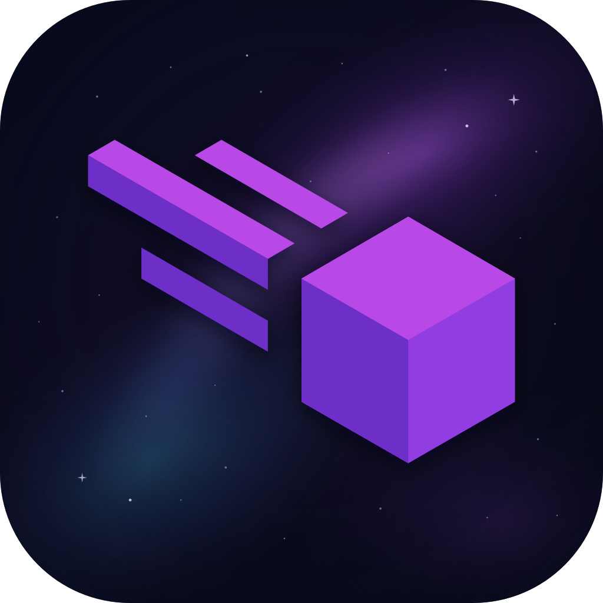
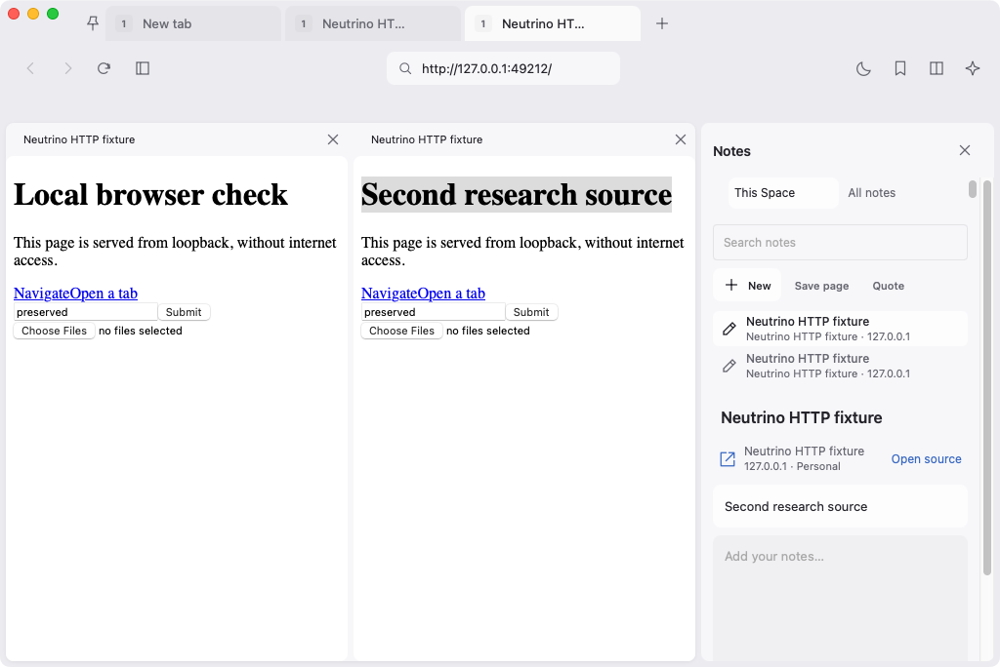
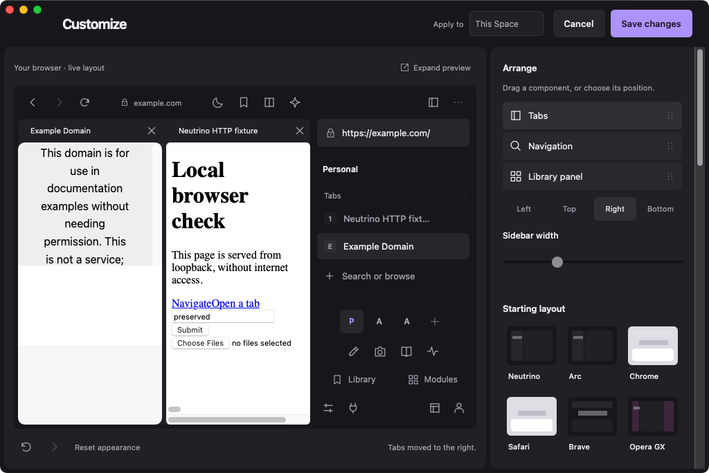
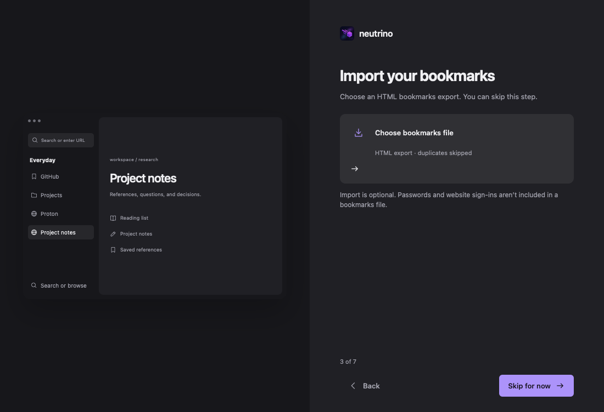

<p align="center">
  
</p>
<h1 align="center">Neutrino</h1>
<p align="center">Keep your sources, notes, and live pages together.</p>
<p align="center">
  <a href="https://github.com/starharbor2491/neutrino-browser/releases">Download for Apple Silicon</a> ·
  <a href="docs/TESTING.md">Build & test</a> ·
  <a href="docs/PRODUCT_PLAN.md">Roadmap</a> ·
  <a href="https://github.com/starharbor2491/neutrino-browser/issues">Report an issue</a>
</p>

Neutrino keeps pages, reference tabs, and local notes together in a workspace. Start with a familiar browser layout, then adjust it around the way you work. Blink and WebKit run behind an interface rendered in Rust.

**Development preview.** This is an actively developed browser, with incomplete compatibility and release gates. See the [release status](docs/RELEASE_STATUS.md) before replacing your everyday browser. Downloadable releases contain `Neutrino.app` as a ZIP and a complete offline DMG.

With Homebrew, this repository is its own tap:

```sh
brew tap starharbor2491/neutrino https://github.com/starharbor2491/neutrino-browser
brew install --cask neutrino
```

Previews are not notarized, so macOS blocks the first launch; choose Open Anyway in System Settings > Privacy & Security. Neutrino then updates itself.



*Native macOS/WebKit capture: two local sample articles beside source-linked Notes, using a dark vertical layout.*

## A workspace for actual work

- **Command-first browsing.** Open a destination with ⌘T, switch pages with ⌘K, and edit the current address with ⌘L. Cancelling a new destination leaves your live page alone.
- **Research beside the page.** Save source-linked quotes, search note bodies and quotations, and compare live pages beside your notes. Distinct excerpts identify each capture. Open source returns to the original tab after a Space move without hiding the note or discarding its draft.
- **Spaces and Profiles.** Organize tabs and folders into Spaces; keep website accounts and browsing data in separate Profiles. Move and reorder tabs directly.
- **Familiar starting layouts.** Neutrino, Arc, Chrome, Safari, Brave, and Opera GX inspired presets configure arrangement, density, color, and tool placement. These are Neutrino layouts, not replicas or affiliated products.
- **A working appearance editor.** Dock components, resize panels, choose SVG icons, adjust type and corners, and save, rename, replace, or delete reusable setups. Preview changes, undo them, or cancel without applying them.
- **Tools that show up.** Enable a module to add its controls or presentation to the workspace. Local packages can supply constrained behavior, themes, layouts, SVG paths, menus, and widgets.

<details>
<summary>Appearance editor and guided setup</summary>




</details>

## Local by default

Browser data lives outside the application bundle. Passwords and optional AI credentials use macOS Keychain. AI stays off until configured; page content is shared through explicit actions. Neutrino has no hosted sync, VPN, cloud storage, or add-on store.

Updates replace the complete application, including its pinned Chromium runtime, while preserving browser data. Sparkle 2 integration uses signed GitHub feeds when publisher keys are configured; older builds retain a verified GitHub update bridge. [Distribution and signing requirements](docs/DISTRIBUTION.md).

Full uninstall is an explicit, irreversible operation: it removes the app and its browser data, caches, settings, and credentials. Downloaded and exported files are preserved.

## Build

Requires Apple Silicon, macOS 14 or newer, Swift 6/Xcode, Rust 1.88+, Python 3, and CMake. Initial builds fetch the pinned CEF SDK and checksum-pinned Sparkle framework. Installed releases contain the required runtime components.

```sh
./scripts/test.sh
./scripts/build-app.sh
python3 scripts/package-release.py --development
```

For interface development without the Blink payload:

```sh
NEUTRINO_WEBKIT_DEVELOPMENT_ONLY=1 ./scripts/build-app.sh
```

The Rust renderer can also run in a local fixture harness:

```sh
cargo run --bin preview -p neutrino-shell
```

The harness is for interaction testing; it does not certify native engine behavior.

## Architecture

| Layer | Implementation |
| --- | --- |
| Interface, reducer, presets, SVG icons, appearance policy | Rust / Maud |
| SQLite storage, sessions/Spaces/profiles, module repository/programs, imports, release and identity policy | Rust |
| Removable Reader, CPU and memory module executables | Rust |
| macOS windows, WKWebView/CEF ownership, Keychain, native framework adapters | Swift / Objective-C++ |
| SDK builds, packaging, signing, release and acceptance automation | Python / shell |

Rust owns the interface and portable services. Swift and Objective-C++ connect them to macOS frameworks and the browser engines. Python handles repository automation; **no Python runtime ships in the app**. See [architecture](docs/RUST_ARCHITECTURE.md) and [verified feature coverage](docs/PARITY.md).

## Contributing

Reproduce the issue, describe the expected behavior, and include the build and engine involved. Please keep changes focused and run the relevant checks. Design changes should demonstrate the interaction in a populated workspace, including keyboard access and reduced motion. [Gauntlet review process](docs/GAUNTLET.md).

[Engine integration](docs/CHROMIUM.md) · [Design](docs/DESIGN.md) · [AI](docs/AI.md) · [Licensing](docs/LICENSING.md)

New code is licensed under MPL-2.0. The original repository retains its MIT license; third-party notices ship with the app. The supplied Neutrino logo is preserved.
